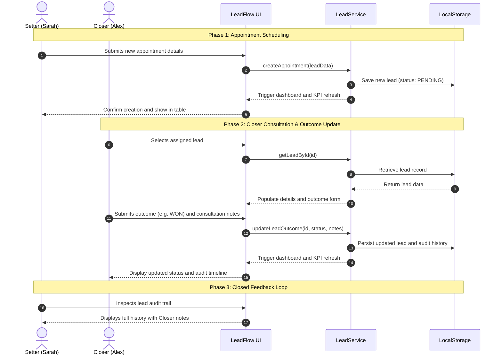

# LeadFlow — Lead & Appointment Management System

[](https://developer.mozilla.org/en-US/docs/Web/JavaScript)
[](https://developer.mozilla.org/en-US/docs/Web/HTML)
[](https://developer.mozilla.org/en-US/docs/Web/CSS)
[]()
[]()
[]()
[]()
[](LICENSE)

---

## 1. Project Overview

**LeadFlow** is a web-based, role-oriented lead and appointment management platform engineered for sales teams. The application models the collaborative pipeline between front-line **Appointment Setters** (who qualify inbound/outbound prospects and schedule discovery consultations) and **Closers** (account executives who conduct consultations, advance opportunity stages, and document deal outcomes).

Developed as a university group project for a **Software Design Principles and Patterns** course, LeadFlow serves as a rigorous reference implementation of **SOLID principles**, **GoF design patterns**, and **GRASP guidelines** implemented entirely in **vanilla JavaScript (ES6+)**, **HTML5**, and **CSS3**, without third-party frameworks, bundlers, or external database dependencies.

```
┌─────────────────────────────────┐                             ┌─────────────────────────────────┐
│       Appointment Setter        │      1. Qualify & Assign    │             Closer              │
│    (e.g., Sarah Jenkins)        │ ──────────────────────────> │      (e.g., Alex Rivera)        │
│ • Intakes prospect data         │                             │ • Conducts consultation         │
│ • Schedules appointments        │ <────────────────────────── │ • Advances deal status          │
│ • Inspects live deal history    │     2. Immutable Outcomes   │ • Adds consultation notes       │
└─────────────────────────────────┘                             └─────────────────────────────────┘
```

### Key Highlights
- **Framework-Free Core:** 100% vanilla ES6+ modules; runs directly in modern browsers without Babel, Webpack, or Vite build steps.
- **Role-Based Workspaces:** Dedicated views and workflows for Appointment Setters and Closers with dynamic account switching.
- **Immutable Audit Trail:** Chronological history tracking of every status transition, outcome note, timestamp, and responsible user.
- **Zero-Backend Persistence:** Robust `localStorage` engine with JSON serialization, schema reconstitution, and error handling.
- **Enterprise-Grade Architecture:** Clean separation of concerns through Layered MVC, Repository, Observer, and Dependency Injection patterns.

---

## 2. System Architecture & Design Principles

The application is structured into clearly separated architectural layers to ensure high cohesion, loose coupling, and maintainability.

```
┌─────────────────────────────────────────────────────────────────────────┐
│                           PRESENTATION LAYER                            │
│                 (index.html, styles.css, DOM Elements)                  │
└────────────────────────────────────┬────────────────────────────────────┘
                                     │ User Actions & DOM Events
                                     ▼
┌─────────────────────────────────────────────────────────────────────────┐
│                            CONTROLLER LAYER                             │
│   ├── AppController.js         (Lifecycle, Global User Switcher, Shell) │
│   ├── DashboardController.js   (KPIs, Reactive Table, Search & Filter)  │
│   └── ModalController.js       (Create Appointment, Details & Outcomes) │
└──────────────┬───────────────────────────────────────────┬──────────────┘
               │ Calls Operations                          │ Listens via Events
               ▼                                           ▼
┌─────────────────────────────────────────────────────────────────────────┐
│                              SERVICE LAYER                              │
│   ├── LeadService.js   (Business Rules, Validation, Permissions, Stats) │
│   ├── UserService.js   (Demo Accounts, Active User State Management)    │
│   └── EventEmitter.js  (Publish-Subscribe Event Bus)                    │
└──────────────┬──────────────────────────────────────────────────────────┘
               │ Reads / Persists Domain Entities
               ▼
┌─────────────────────────────────────────────────────────────────────────┐
│                            REPOSITORY LAYER                             │
│   ├── ILeadRepository.js            (Abstract Interface Contract - DIP) │
│   └── LocalStorageLeadRepository.js (Concrete Browser Storage Adapter)  │
└──────────────┬──────────────────────────────────────────────────────────┘
               │ Hydrates / Serializes
               ▼
┌─────────────────────────────────────────────────────────────────────────┐
│                          DOMAIN / MODEL LAYER                           │
│   ├── Lead.js          (Lead Entity: Status, Assignment, State Transitions)│
│   ├── HistoryEntry.js  (Immutable Audit Record Entity)                  │
│   └── User.js          (User Identity, Role Capabilities)               │
└─────────────────────────────────────────────────────────────────────────┘
```

---

## 3. Application of SOLID Principles

| Principle | Architectural Implementation in LeadFlow |
| :--- | :--- |
| **Single Responsibility Principle (SRP)** | Every module has one single actor and reason to change. `LocalStorageLeadRepository` handles data serialization exclusively; `LeadService` enforces business policies and assignment permissions; `Sanitizer` provides XSS protection; `DashboardController` manages table rendering and filter logic. |
| **Open/Closed Principle (OCP)** | Storage access is governed by the `ILeadRepository` interface contract. Persisting to `IndexedDB`, a RESTful API, or Firebase in the future requires adding a new repository subclass without modifying existing service or controller logic. Lead statuses and service categories are maintained via extensible enumeration objects. |
| **Liskov Substitution Principle (LSP)** | `LocalStorageLeadRepository` strictly adheres to all method signatures and return contracts defined in `ILeadRepository`. Any consumer expecting `ILeadRepository` can consume `LocalStorageLeadRepository` without runtime surprises. |
| **Interface Segregation Principle (ISP)** | Interface contracts specify only essential domain requirements (`save`, `update`, `getAll`, `getById`, `getByCloserId`, `getBySetterId`). Consumers are never forced to depend on methods they do not require. |
| **Dependency Inversion Principle (DIP)** | High-level business logic (`LeadService`) does **not** import or instantiate low-level storage adapters (`LocalStorageLeadRepository` or `window.localStorage`). Instead, dependencies are injected into constructors via the Composition Root (`app.js`). |

---

## 4. Design Patterns Implemented

### 4.1 GoF (Gang of Four) Patterns

1. **Repository Pattern (`ILeadRepository`, `LocalStorageLeadRepository`):**  
   Encapsulates the data access layer, mediating between domain entities (`Lead`) and the underlying persistence technology (`localStorage`).

2. **Observer / Publish-Subscribe Pattern (`EventEmitter`):**  
   Facilitates reactive, decoupled UI updates. When `LeadService` performs mutations, it publishes `lead:created` or `lead:updated` events. The `DashboardController` listens for these events and re-renders metrics and table rows automatically without tight circular couplings.

3. **Factory Method Pattern (`Lead.fromJSON`, `HistoryEntry.fromJSON`, `User.fromJSON`):**  
   Encapsulates the instantiation and validation logic required to reconstruct rich domain model instances from deserialized plain JSON objects.

4. **Model-View-Controller (MVC):**  
   - **Model:** `Lead`, `User`, `HistoryEntry` encapsulate application state, domain integrity, and state transitions.
   - **View:** Declarative HTML5 templates and CSS custom properties.
   - **Controller:** `AppController`, `DashboardController`, and `ModalController` handle DOM events, bind user interactions, and coordinate updates.

5. **Dependency Injection (Composition Root in `app.js`):**  
   All instances (`ILeadRepository`, `LeadService`, `UserService`, `EventEmitter`, and controllers) are created and wired together in one centralized entry point.

### 4.2 GRASP (General Responsibility Assignment Software Patterns)

- **Information Expert:** The `Lead` entity manages its own status updates and history entries, because it possesses all information required to maintain the audit trail.
- **Creator:** The `Lead` entity creates instances of `HistoryEntry` whenever an outcome note or status transition occurs.
- **Controller:** Distinct controllers (`AppController`, `DashboardController`, `ModalController`) serve as entry points for DOM events before invoking the service layer.
- **Low Coupling & High Cohesion:** Responsibilities are strictly partitioned, minimizing dependencies across domain boundaries.

---

## 5. Architectural Diagrams

The repository includes visual specifications modeled in PlantUML. High-resolution vector diagrams can be inspected in the [`ProjectDesign/`](./ProjectDesign/) directory:

- [PlantUML Structural Class Diagram](./ProjectDesign/LFlow_Structural_Diagram.puml)
- [SVG Structural Class Diagram](./ProjectDesign/LFlow_Structural_Diagram.svg)
- [PlantUML Sequence Diagram](./ProjectDesign/LFlow_Sequence_Diagram.puml)
- [SVG Sequence Diagram](./ProjectDesign/LFlow_Sequence_Diagram.svg)

### 5.1 End-to-End Sequence Diagram



---

## 6. Project Directory Structure

```
LeadFlow/
├── index.html                           # Semantic HTML5 entry document & accessible UI shell
├── README.md                            # Complete technical and architectural documentation
├── server.ps1                           # Lightweight PowerShell static server (zero npm dependencies)
├── ProjectDesign/
│   ├── LFlow_Structural_Diagram.puml    # PlantUML structural class diagram
│   ├── LFlow_Structural_Diagram.svg     # Rendered vector structural diagram
│   ├── LFlow_Sequence_Diagram.puml      # PlantUML end-to-end sequence diagram
│   └── LFlow_Sequence_Diagram.svg       # Rendered vector sequence diagram
├── css/
│   └── styles.css                       # Modern SaaS design system with CSS custom properties
└── js/
    ├── app.js                           # Composition Root & Dependency Injection bootstrapper
    ├── core/
    │   ├── Constants.js                 # LeadStatus, UserRoles, ServiceOptions, StorageKeys
    │   └── EventEmitter.js              # Observer / Publish-Subscribe implementation
    ├── models/
    │   ├── User.js                      # User domain entity with role helper methods
    │   ├── Lead.js                      # Lead domain entity with encapsulated audit logic
    │   └── HistoryEntry.js              # Immutable audit trail record entity
    ├── repositories/
    │   ├── ILeadRepository.js           # Abstract repository interface contract (DIP)
    │   └── LocalStorageLeadRepository.js# Browser localStorage concrete realization
    ├── services/
    │   ├── UserService.js               # Demo accounts & active user session state
    │   └── LeadService.js               # Business logic, validation, permissions, statistics
    ├── controllers/
    │   ├── AppController.js             # Master controller, user switcher, app lifecycle
    │   ├── DashboardController.js       # KPI metrics cards, responsive table, search & filters
    │   └── ModalController.js           # Create Lead modal, Lead Details & Closer outcome form
    ├── utils/
    │   ├── Sanitizer.js                 # XSS prevention, entity encoding, safe formatting
    │   ├── DateFormatter.js             # Human-friendly dates, 12h times, and relative timestamps
    │   └── Toast.js                     # Accessible floating feedback alerts
    └── data/
        └── seedData.js                  # Realistic demo leads across all stages with full histories
```

---

## 7. Demo Accounts & Role Permissions Matrix

LeadFlow includes four built-in demo profiles to simulate realistic sales operations without requiring an external identity provider:

| User Name | Role | ID | Email Address | Assigned Permissions & Scope |
| :--- | :--- | :--- | :--- | :--- |
| **Sarah Jenkins** | `Appointment Setter` | `setter-1` | `sarah.jenkins@leadflow.io` | Can create appointments; views appointments submitted by Sarah; views closer outcome notes and full audit history. |
| **Marcus Vance** | `Appointment Setter` | `setter-2` | `marcus.vance@leadflow.io` | Can create appointments; views appointments submitted by Marcus; views closer outcome notes and full audit history. |
| **Alex Rivera** | `Closer` | `closer-1` | `alex.rivera@leadflow.io` | Views appointments assigned to Alex; updates lead statuses; records consultation outcome notes. |
| **Elena Rostova** | `Closer` | `closer-2` | `elena.rostova@leadflow.io` | Views appointments assigned to Elena; updates lead statuses; records consultation outcome notes. |

> **Note on Role Switching:** The client-side role switcher in the application header is a demonstration mechanism designed for grading and evaluation. In production environments, role assignments are securely verified via server-side session tokens or JWT authentication.

---

## 8. Supported Lead Status Lifecycle

```
             ┌───────────────┐
             │    PENDING    │ (Initial State on Creation)
             └───────┬───────┘
                     │ Closer outreach begins
                     ▼
             ┌───────────────┐
     ┌───────┤   CONTACTED   ├───────┐
     │       └───────┬───────┘       │
     ▼               ▼               ▼
┌─────────┐   ┌─────────────┐   ┌────────────┐
│ NO      │   │ INTERESTED  │   │ FOLLOW-UP  │
│ ANSWER  │   └──────┬──────┘   │  REQUIRED  │
└─────────┘          │          └─────┬──────┘
                     │ Final Outcome  │
            ┌────────┴────────┐       │
            ▼                 ▼       ▼
      ┌───────────┐     ┌───────────┐ │
      │    WON    │     │   LOST    ├─┘
      │ (Success) │     │  (Closed) │
      └───────────┘     └───────────┘
```

1. **`Pending`:** Lead has been scheduled by an Appointment Setter and assigned to a Closer.
2. **`Contacted`:** Closer has initiated contact via phone or email.
3. **`Interested`:** Prospect confirmed interest and attended the consultation.
4. **`Follow-up Required`:** Prospect requested additional collateral, customized quote, or revised timeline.
5. **`No Answer`:** Closer attempted outreach but could not reach the prospect.
6. **`Won`:** Sale closed and contract executed (Terminal success state).
7. **`Lost`:** Prospect declined services or chose an alternate provider (Terminal closed state).

---

## 9. How to Run the Application

Because LeadFlow is built using standard **ES6 Modules (`import`/`export`)**, modern web browsers restrict module loading over the `file://` protocol due to **CORS security policies**. A local HTTP static server is required to serve the files.

**No Node.js build step, bundler (`npm install`, webpack, Vite), or package manager is required.**

### Option A: VS Code Live Server Extension (Recommended)
1. Open Visual Studio Code.
2. Select **File > Open Folder...** and choose the `leadflow` root directory.
3. Install the **Live Server** extension by Ritwick Dey (ID: `ritwickdey.LiveServer`).
4. Right-click [`index.html`](./index.html) in the Explorer sidebar.
5. Click **"Open with Live Server"**.
6. Your default browser will launch at `http://127.0.0.1:5500/`.

### Option B: Built-in PowerShell Static Server (Zero Installs)
LeadFlow includes a native PowerShell static HTTP server script ([`server.ps1`](./server.ps1)):
1. Open PowerShell in the `leadflow` root folder:
   ```powershell
   powershell -ExecutionPolicy Bypass -File .\server.ps1 -port 8080
   ```
2. Open your web browser and navigate to:  
   **`http://localhost:8080/`**

### Option C: Python HTTP Server (Built into Python 3)
```bash
python -m http.server 8080
```
Open **`http://localhost:8080/`** in your browser.

### Option D: Node.js `npx serve`
```bash
npx serve .
```

---

## 10. Functional Testing & Demonstration Checklist

This step-by-step checklist validates all requirements for peer review and grading:

- [ ] **1. Initial Load & Seed Data Verification:**
  - Launch the application via local server.
  - Confirm **Sarah Jenkins (Appointment Setter)** is active by default.
  - Confirm KPI cards display metrics: **Total Submitted**, **Pending Outreach**, **Follow-ups Required**, and **Deals Won**.
  - Confirm the lead table displays pre-seeded appointments submitted by Sarah.

- [ ] **2. Search & Filter Verification:**
  - Enter a prospect name (e.g., `Danielle`) in the search input; verify real-time table filtering.
  - Clear the search field; confirm all leads reappear.
  - Select `Pending` in the status dropdown; verify only pending leads are shown.
  - Reset status filter to `All Statuses`.

- [ ] **3. Appointment Creation (Setter Flow):**
  - Click **"+ New Appointment"**.
  - Fill in required customer details:
    - Customer Name: `Acme Innovations`
    - Phone: `(555) 888-9999`
    - Email: `contact@acme.io`
    - Service Interest: `AI Workflow Automation`
    - Appointment Date & Time: Any upcoming slot
    - Assigned Closer: `Alex Rivera`
    - Qualification Notes: `Urgent inbound inquiry from enterprise lead.`
  - Submit the form.
  - Verify success toast notification appears, the modal closes, the new lead appears at the top of the table with status `Pending`, and the "Total Submitted" KPI increments.

- [ ] **4. Lead Audit History Inspection:**
  - Click **"View Details"** on the newly created lead.
  - Verify that the customer meta and assignment info match the submitted values.
  - Confirm the **Audit History & Timeline** reflects the initial creation event with Sarah's name, timestamp, and notes.
  - Confirm a read-only message indicates Sarah is the setter and only Alex Rivera can record outcomes.

- [ ] **5. Role Switching & Closer Workspace:**
  - In the header account selector, switch to **"Alex Rivera (Closer)"**.
  - Verify the header badge transitions to Closer styling and the workspace banner updates.
  - Verify the "+ New Appointment" button is hidden (Closers cannot schedule appointments).
  - Verify the table displays only appointments assigned to Alex Rivera, including `Acme Innovations`.

- [ ] **6. Status Advancement & Outcome Recording (Closer Flow):**
  - Click **"Update & History"** on `Acme Innovations`.
  - Confirm the **Update Lead Outcome** form is enabled.
  - Change status to **"Interested"** and enter outcome notes: `Conducted initial discovery call. Prospect requested formal pilot proposal.`
  - Click **"Save Status Update"**.
  - Confirm success toast and verify that the timeline immediately appends an immutable entry showing `Pending → Interested` by Alex Rivera.

- [ ] **7. Closed Feedback Loop (Setter Synchronization):**
  - Switch the active user back to **"Sarah Jenkins (Appointment Setter)"**.
  - Observe `Acme Innovations` in the table: its status badge has automatically updated to **Interested**.
  - Click **"View Details"**: confirm Alex Rivera's outcome notes and transition record are visible in the timeline.

- [ ] **8. Persistence & Refresh Reliability:**
  - Refresh the browser (`F5` or `Ctrl+R`).
  - Confirm all newly scheduled leads and status updates persist cleanly from `localStorage`.

- [ ] **9. Input Validation & XSS Defense:**
  - Attempt to submit the appointment form with empty fields; verify HTML5 and JavaScript validation errors.
  - Test defensive sanitization by entering `<script>alert('xss')</script>` in customer notes; verify safe entity escaping in the DOM.

- [ ] **10. Responsive Design:**
  - Open Chrome/Edge DevTools (`F12`) and activate responsive device mode (`Ctrl+Shift+M`).
  - Verify layout adaptation on tablet and mobile viewports with horizontal scroll safety and responsive cards.

---

## 11. Security & Validation Practices

- **Context-Aware XSS Prevention:**  
  All user-supplied content (names, phone numbers, emails, notes) passes through [`Sanitizer.escapeHTML()`](./js/utils/Sanitizer.js) before insertion into the DOM, preventing script injection attacks.
- **Strict Input Validation:**  
  Names must meet minimum length criteria, phone numbers must adhere to numerical formats, emails are checked against standard syntax, and closer assignments are strictly validated against existing closer IDs.
- **Storage Resilience:**  
  Persistence calls are wrapped in defensive `try/catch` blocks handling quota limits (`QuotaExceededError`) and corrupted entries with non-destructive fallback mechanisms.

---

## 12. Authors & Academic Attribution

- **Project Name:** LeadFlow
- **Course:** Software Design Principles and Patterns
- **Repository:** [https://github.com/00dnn/LeadFlow](https://github.com/00dnn/LeadFlow)
- **Primary Technologies:** HTML5, CSS3, Vanilla JavaScript (ES6+), PlantUML
- **License:** Educational Open Source / [MIT](LICENSE)
