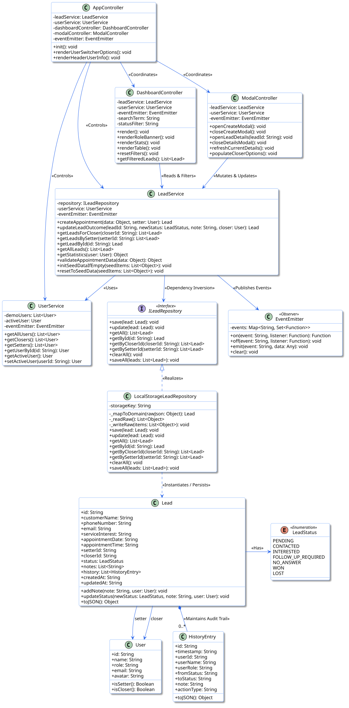
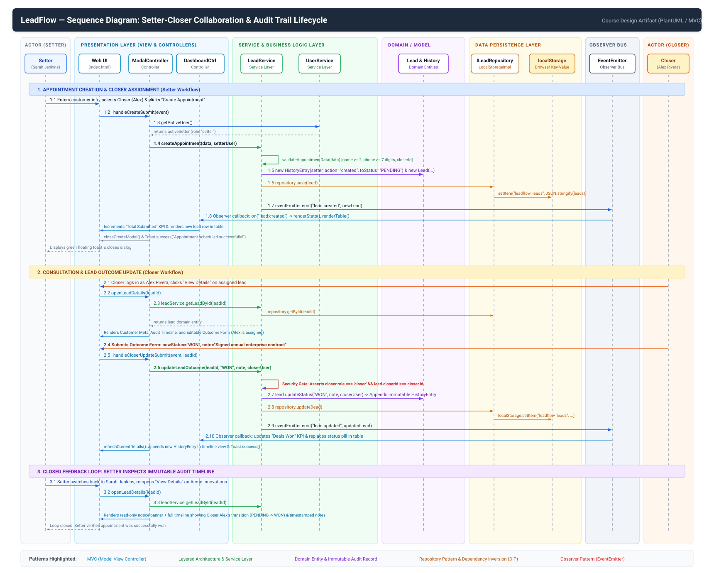
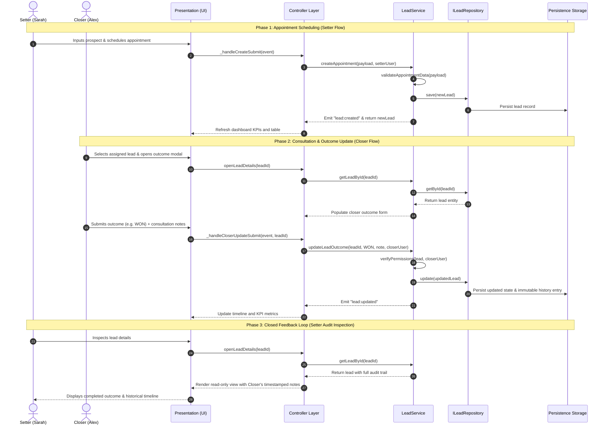

# LeadFlow — Lead & Appointment Management System

### Part 1: System Design & Object-Oriented Modeling

[]()
[-2563EB)](https://plantuml.com/)
[]()
[]()
[]()
[%20%7C%20HTML5%20%7C%20CSS3-yellow)]()
[](LICENSE)

---

## 1. Project Overview & Scope

**LeadFlow** is an enterprise-modeled, role-oriented lead and appointment management platform designed for sales operations. The system models the collaborative pipeline between front-line **Appointment Setters** (who qualify inbound/outbound prospects and schedule discovery consultations) and **Closers** (account executives who conduct consultations, advance opportunity stages, and document deal outcomes).

```
┌─────────────────────────────────┐                             ┌─────────────────────────────────┐
│       Appointment Setter        │      1. Qualify & Assign    │             Closer              │
│     (e.g., Sarah Jenkins)       │ ──────────────────────────> │      (e.g., Alex Rivera)        │
│ • Intakes prospect data         │                             │ • Conducts consultation         │
│ • Schedules appointments        │ <────────────────────────── │ • Advances deal status          │
│ • Inspects live deal history    │     2. Immutable Outcomes   │ • Records consultation notes    │
└─────────────────────────────────┘                             └─────────────────────────────────┘
```

### Academic Context & Project Milestones
Developed for a university course in **Software Design Principles and Patterns**, this project follows a multi-phase engineering lifecycle:

- **Part 1 (Current Deliverable):** System Architecture, Object-Oriented Analysis & Design (OOAD), formal **Structural Class Diagram**, and **End-to-End Sequence Diagram** incorporating SOLID design principles, GoF patterns, and GRASP guidelines.
- **Part 2 (Future Phase):** Full-stack client implementation translating these architectural models into code (planned in vanilla ES6+ JavaScript, semantic HTML5, and CSS3).

> [!NOTE]
> **Part 1 Focus:** This repository and document currently focus on the architectural modeling deliverables (Class and Sequence Diagrams). Source code implementation and runtime testing will be completed in subsequent project phases.

---

## 2. System Architecture

The system is designed around a decoupled, 5-layer architecture ensuring high cohesion, low coupling, and strict compliance with the **Dependency Inversion Principle (DIP)**:

```
┌─────────────────────────────────────────────────────────────────────────┐
│                           PRESENTATION LAYER                            │
│           (Web UI Views, DOM Interface, Semantic Templates)             │
└────────────────────────────────────┬────────────────────────────────────┘
                                     │ User Actions & UI Events
                                     ▼
┌─────────────────────────────────────────────────────────────────────────┐
│                            CONTROLLER LAYER                             │
│   ├── AppController            (Application Lifecycle, Shell, Auth)    │
│   ├── DashboardController      (KPI Metrics, Reactive Table, Filtering) │
│   └── ModalController          (Appointment Intake, Outcome Modals)    │
└──────────────┬───────────────────────────────────────────┬──────────────┘
               │ Invokes Operations                        │ Listens via Events
               ▼                                           ▼
┌─────────────────────────────────────────────────────────────────────────┐
│                              SERVICE LAYER                              │
│   ├── LeadService      (Business Rules, Validation, Permissions, Stats) │
│   ├── UserService      (User Directory, Active Session State)           │
│   └── EventEmitter     (Observer / Publish-Subscribe Event Bus)         │
└──────────────┬──────────────────────────────────────────────────────────┘
               │ Reads / Persists Domain Entities
               ▼
┌─────────────────────────────────────────────────────────────────────────┐
│                            REPOSITORY LAYER                             │
│   ├── ILeadRepository            (Abstract Interface Contract - DIP)    │
│   └── LocalStorageLeadRepository (Concrete Browser Storage Realization) │
└──────────────┬──────────────────────────────────────────────────────────┘
               │ Reconstitutes / Serializes
               ▼
┌─────────────────────────────────────────────────────────────────────────┐
│                          DOMAIN / MODEL LAYER                           │
│   ├── Lead             (Core Aggregate Root: Status, Assignment)       │
│   ├── HistoryEntry     (Immutable Audit Record Entity)                  │
│   ├── User             (Actor Identity & Role Capabilities)             │
│   └── LeadStatus       (Enumeration of Valid Pipeline Stages)           │
└─────────────────────────────────────────────────────────────────────────┘
```

---

## 3. Part 1 Deliverables: UML Modeling Specifications

The core deliverables for **Part 1** are maintained as formal PlantUML models and high-resolution vector diagrams in the [`ProjectDesign/`](./ProjectDesign/) directory.

| Diagram Type | PlantUML Source File | Rendered Vector Output | Primary Focus |
| :--- | :--- | :--- | :--- |
| **Structural Class Diagram** | [`LFlow_Structural_Diagram.puml`](./ProjectDesign/LFlow_Structural_Diagram.puml) | [`LFlow_Structural_Diagram.svg`](./ProjectDesign/LFlow_Structural_Diagram.svg) | Static structure, entities, interface contracts, and relationships |
| **End-to-End Sequence Diagram** | [`LFlow_Sequence_Diagram.puml`](./ProjectDesign/LFlow_Sequence_Diagram.puml) | [`LFlow_Sequence_Diagram.svg`](./ProjectDesign/LFlow_Sequence_Diagram.svg) | Dynamic message passing, lifecycle workflows, and layer interactions |

---

### 3.1 Structural Class Diagram

The structural class diagram specifies all classes, data attributes, method signatures, visibility modifiers, and associations across the entire architecture.



#### Architectural Breakdown of Modeled Components:

1. **Domain Model Layer:**
   - **`Lead` (Aggregate Root):** Encapsulates core appointment data (`customerName`, `phoneNumber`, `email`, `serviceInterest`, `appointmentDate`, `appointmentTime`, `setterId`, `closerId`), manages current pipeline status (`LeadStatus`), and owns the audit history list.
   - **`HistoryEntry` (Entity):** Immutable audit log item capturing every status transition, outcome note, timestamp, author ID, and user role.
   - **`User` (Entity):** Represents sales team actors with role-checking methods (`isSetter()`, `isCloser()`).
   - **`LeadStatus` (`<<Enumeration>>`):** Formal lifecycle states (`PENDING`, `CONTACTED`, `INTERESTED`, `FOLLOW_UP_REQUIRED`, `NO_ANSWER`, `WON`, `LOST`).

2. **Repository Layer (Persistence Abstraction):**
   - **`ILeadRepository` (`<<Interface>>`):** Establishes the persistence contract (`save`, `update`, `getAll`, `getById`, `getByCloserId`, `getBySetterId`, `clearAll`, `saveAll`).
   - **`LocalStorageLeadRepository`:** Concrete implementation of `ILeadRepository` targeting browser storage. Insulates domain logic from the underlying storage mechanism.

3. **Service Layer (Business Logic & Messaging):**
   - **`LeadService`:** Enforces domain constraints, validates appointment inputs, asserts closer permissions before status mutations, and compiles operational metrics.
   - **`UserService`:** Manages user directory, demo profiles, and active session context.
   - **`EventEmitter` (`<<Observer>>`):** Centralized publish-subscribe bus for decoupled asynchronous event notifications (`lead:created`, `lead:updated`).

4. **Controller Layer (Application Coordination):**
   - **`AppController`:** Orchestrates top-level application bootstrapping and active user transitions.
   - **`DashboardController`:** Handles KPI metrics computation, real-time table rendering, and multi-criteria filtering.
   - **`ModalController`:** Coordinates UI dialogs for appointment scheduling and closer outcome updates.

---

### 3.2 End-to-End Behavioral Sequence Diagram

The sequence diagram documents the complete lifecycle and message flow across all 5 architectural layers through 3 sequential operational phases.





#### Detailed Workflow Phases:

1. **Phase 1: Appointment Setter Schedules & Assigns Lead**
   - The Setter submits prospect information and assigns a designated Closer.
   - `ModalController` acquires the active user session from `UserService` and invokes `LeadService.createAppointment()`.
   - `LeadService` validates all input fields, instantiates an initial `HistoryEntry` (marking creation), builds the `Lead` aggregate, and persists it via `ILeadRepository`.
   - `LeadService` dispatches a `lead:created` event over the `EventEmitter` bus, triggering `DashboardController` to dynamically refresh metrics and table rows.

2. **Phase 2: Assigned Closer Conducts Consultation & Records Outcome**
   - The Closer opens their assigned lead; `ModalController` retrieves the record and presents the outcome update interface.
   - The Closer records the consultation outcome (e.g., advancing status to `WON` or `FOLLOW_UP_REQUIRED`) with detailed notes.
   - `LeadService` asserts authorization: verifying that the user has the `closer` role and matches the lead's `closerId`.
   - `Lead.updateStatus()` generates a new immutable `HistoryEntry` documenting the transition, appends it to the history list, and persists the entity.
   - A `lead:updated` event notifies subscriber controllers to update KPI summaries.

3. **Phase 3: Closed Feedback Loop & History Inspection**
   - The original Setter inspects the lead to review consultation results.
   - The UI presents a read-only, chronological audit timeline displaying the Closer's timestamped notes and status changes, completing the operational feedback loop.

---

## 4. Application of SOLID Principles

The system architecture and UML models strictly adhere to the five SOLID principles:

| Principle | Architectural Application in LeadFlow |
| :--- | :--- |
| **Single Responsibility Principle (SRP)** | Each class has one well-defined responsibility and reason to change. `LocalStorageLeadRepository` handles persistence only; `LeadService` manages business rules and permissions; `DashboardController` coordinates table and KPI rendering; `Lead` manages its domain state and internal history. |
| **Open/Closed Principle (OCP)** | Storage access is abstracted behind the `ILeadRepository` contract. Switching to an alternative persistence mechanism (such as `IndexedDB` or a REST API) requires adding a new repository subclass without altering existing service or controller code. |
| **Liskov Substitution Principle (LSP)** | `LocalStorageLeadRepository` satisfies the full semantic and structural contract defined by `ILeadRepository`. Any consumer requiring `ILeadRepository` can seamlessly consume `LocalStorageLeadRepository` without side effects. |
| **Interface Segregation Principle (ISP)** | The `ILeadRepository` interface provides a cohesive, role-tailored API (`save`, `update`, `getAll`, `getById`, `getByCloserId`, `getBySetterId`) without burdening consumers with superfluous methods. |
| **Dependency Inversion Principle (DIP)** | High-level business policies (`LeadService`) depend entirely on the abstraction `ILeadRepository`, rather than on concrete storage implementations. Concrete dependencies are injected during composition. |

---

## 5. Design Patterns Modeled

### 5.1 Gang of Four (GoF) Patterns

1. **Repository Pattern (`ILeadRepository`, `LocalStorageLeadRepository`):**  
   Decouples the domain and service layers from storage technologies, providing an in-memory collection-like interface for domain entities.

2. **Observer / Publish-Subscribe Pattern (`EventEmitter`):**  
   Provides loosely-coupled, event-driven communication between the service layer and presentation controllers when domain mutations occur.

3. **Model-View-Controller (MVC):**  
   - **Model:** `Lead`, `User`, and `HistoryEntry` encapsulate business logic, domain invariants, and audit history.
   - **View:** Declarative HTML templates and visual styling.
   - **Controller:** `AppController`, `DashboardController`, and `ModalController` coordinate user interaction and delegate to services.

4. **Dependency Injection:**  
   Services and repositories are instantiated and injected through class constructors, enabling loose coupling and unit testability.

### 5.2 GRASP Guidelines

- **Information Expert:** The `Lead` entity maintains its own status transitions and audit history entries because it holds the requisite state information.
- **Creator:** The `Lead` entity creates `HistoryEntry` instances during status updates.
- **Controller:** Dedicated controllers handle incoming UI events before delegating to domain services.
- **Low Coupling & High Cohesion:** Classes are partitioned along clear boundaries with explicit interfaces.

---

## 6. Domain Rules, Roles & State Machine

### 6.1 Role & Permission Matrix

| Capability / Action | Appointment Setter | Closer |
| :--- | :---: | :---: |
| Schedule new prospect appointments | :white_check_mark: | :x: |
| Assign appointments to Closers | :white_check_mark: | :x: |
| View submitted appointments | :white_check_mark: (Own leads) | :white_check_mark: (Assigned leads) |
| Conduct consultations & advance status | :x: | :white_check_mark: |
| Append consultation notes & outcome logs | :x: | :white_check_mark: |
| Review immutable audit timeline | :white_check_mark: | :white_check_mark: |

### 6.2 Lead Status State Machine

```
             ┌───────────────┐
             │    PENDING    │ (Initial State on Creation)
             └───────┬───────┘
                     │ Closer outreach begins
                     ▼
             ┌───────────────┐
     ┌───────┤   CONTACTED   ├───────┐
     │       └───────┬───────┘       │
     ▼               ▼               ▼
┌─────────┐   ┌─────────────┐   ┌────────────┐
│   NO    │   │ INTERESTED  │   │ FOLLOW-UP  │
│ ANSWER  │   └──────┬──────┘   │  REQUIRED  │
└─────────┘          │          └─────┬──────┘
                     │ Final Outcome  │
            ┌────────┴────────┐       │
            ▼                 ▼       ▼
      ┌───────────┐     ┌───────────┐ │
      │    WON    │     │   LOST    ├─┘
      │ (Success) │     │  (Closed) │
      └───────────┘     └───────────┘
```

---

## 7. Current Project Structure (Part 1)

```
LeadFlow/
├── README.md                           # System design specification & Part 1 documentation
└── ProjectDesign/                      # Part 1 Modeling Deliverables
    ├── LFlow_Structural_Diagram.puml   # PlantUML Structural Class Diagram source
    ├── LFlow_Structural_Diagram.svg    # Rendered Vector Structural Diagram
    ├── LFlow_Sequence_Diagram.puml     # PlantUML End-to-End Sequence Diagram source
    └── LFlow_Sequence_Diagram.svg      # Rendered Vector Sequence Diagram
```

---

## 8. Planned Implementation & Technical Roadmap (Future Phase)

While **Part 1** is dedicated to system modeling and architectural design, the diagrams have been constructed to facilitate direct implementation in subsequent phases:

- **Target Architecture:** Pure client-side modular web application using **Vanilla JavaScript (ES6+ Modules)**, **HTML5**, and **CSS3**.
- **Zero-Dependency Philosophy:** No build steps (no Webpack, Vite, or Babel), no external UI frameworks, and no npm package requirements.
- **Persistence Strategy:** Concrete browser `localStorage` adapter implementing `ILeadRepository` with JSON hydration and defensive error handling.
- **Security & Integrity:** Input validation and contextual HTML escaping (XSS prevention) on all user-supplied data.
- **UI/UX Vision:** A modern SaaS workspace featuring dynamic KPI metrics, a reactive appointment table with search/filtering, and modal-based appointment creation and outcome logging workflows.

---

## 9. Academic Attribution & Course Information

- **Project Title:** LeadFlow — Lead & Appointment Management System
- **Course:** Software Design Principles and Patterns
- **Milestone:** Part 1 — Structural & Behavioral System Modeling
- **Repository:** [https://github.com/00dnn/LeadFlow](https://github.com/00dnn/LeadFlow)
- **License:** Educational Open Source / [MIT](LICENSE)
